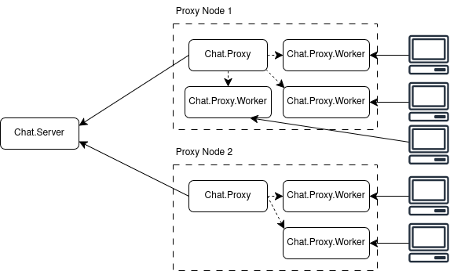

# Chat

A small, concurrent chat system in Elixir.

# Architecture



The architecture is composed of 
distributed Erlang nodes, each containing Elixir
modules such as `Chat.Server`,
`Chat.Proxy` and `Chat.Proxy.Worker`. When a
client connects to a proxy through `inet:tcp`,
the proxy hands the client a worker connection.
The proxy and the server communicate via
`GenServer`. The nicknames are stored in 
the server's ETS table, and the groups
in the workers' table.

# Operation

There are three scripts in the `scripts/`
directory. To run each, do 

```bash
mix run scripts/start_server.exs [server_name]
mix run scripts/start_proxy.exs  [proxy_name]  [server_name]
mix run scripts/start_client.exs [client_name] [proxy_host]
```

Client commands:

These commands are available without setting
the nickname.
```
/l - list all server nicknames
/n [nickname] - set nickname
```

These are available after setting the nickname
```
/g [group_name] [user/group list] - assign users to a group
/d [user/group list] - assign to a default group
/b [message] - broadcast message to default group
/m [user/group list] [msg] - send message to recipients.
```

Valid user nicknames start with a lowercase letter and
can be followed by _, lowercase letters, and digits.

Valid group names start with an uppercase letter and
can be followed by _, lowercase letters, and digits.

Lists can be composed of nicknames and groups simultaneously.

Example:
```
/g Children bart,lisa,maggie
/m Children,marge,ned hello everyone
```

In `lisa`'s client, it would show:
```
homer: hello everyone
```
